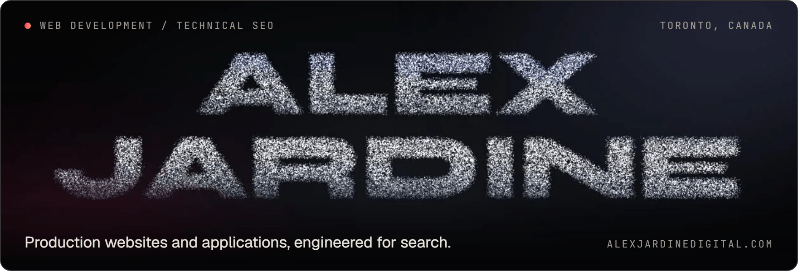
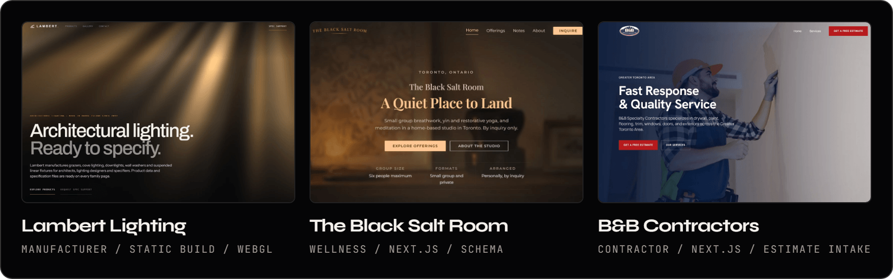
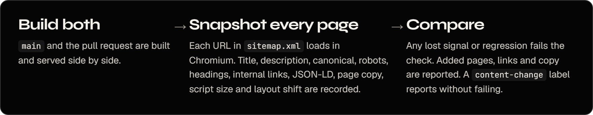

<picture>
  <source media="(max-width: 600px)" srcset="assets/masthead-mobile.png">
  
</picture>

**Web developer and technical SEO in Toronto.** I build production websites and full-stack applications, and the search engineering that keeps them crawlable, indexable and fast. I run [Jardine Studio](https://jardinestudio.com).

[Portfolio](https://alexjardinedigital.com) · [Case studies](https://alexjardinedigital.com/work) · [Working with agencies](https://alexjardinedigital.com/agencies) · [LinkedIn](https://www.linkedin.com/in/alex-jardine/)

## Client websites

<picture>
  <source media="(max-width: 600px)" srcset="assets/client-work-mobile.png">
  
</picture>

### Lambert Architectural Lighting

A 46 MB catalogue PDF rebuilt as a specification website for an architectural lighting manufacturer. I designed and built it on a custom static generator with application-based navigation, comparable specification tables and a WebGL light field. The build fails if a page loses its single H1, an image lacks dimensions or alt text, or a product family goes missing.

[Case study](https://alexjardinedigital.com/work/lambert) · [Live site](https://lambertlighting.com)

### The Black Salt Room

Creative direction, content and a Next.js site for a Toronto breathwork and yoga studio. Offering pages carry the chosen practice into a validated inquiry API, with LocalBusiness, Service, FAQ and article structured data. The launch build scored 100 in all four Lighthouse lab categories.

[Case study](https://alexjardinedigital.com/work/salt) · [Live site](https://www.blacksaltroom.com/)

### B&B Specialty Contractors

A focused Next.js site for a Greater Toronto Area renovation contractor, built around its services, service area and one route to a free estimate. A single service list feeds every page, with page-level metadata and HomeAndConstructionBusiness structured data. The owner reports 17 jobs from the site so far.

[Case study](https://alexjardinedigital.com/work/bb) · [Live site](https://bbspecialtycontractors.com/)

## Technical SEO, built in

Search visibility is decided in templates, routes and the release process, so I treat it as part of the build. [Jardine Studio](https://jardinestudio.com) is the production platform where that runs every day.

<picture>
  <source media="(max-width: 600px)" srcset="assets/page-guard-mobile.png">
  
</picture>

**Page guard** runs on pull requests to the studio site. It fails the check when something search engines or readers rely on is lost:

| Recorded for every sitemap URL | Fails the pull request when |
| --- | --- |
| Title, meta description, canonical, robots | Any value changes |
| Heading outline | A heading's text or level changes |
| Internal links and JSON-LD | A link or block is removed, or a block changes |
| Page copy | A number disappears, or a sentence keeps less than 85% of its words |
| JavaScript | A page ships over 10% or 20 KB more script, whichever is larger |
| Layout shift | CLS grows by more than 0.02 |

Added pages, links and copy are reported, never failed. An intentional copy change is labelled `content-change`, and the guard reports the differences instead of blocking.

The same platform publishes a JSON-LD graph with stable `@id`s, sitemap dates taken from content revisions rather than build time, 53 content-driven redirects and `410 Gone` for retired articles.

[Platform case study](https://alexjardinedigital.com/work/jardine) · [Live site](https://jardinestudio.com)

## Applications

### Silktrace

A live SEO research application built with Next.js, TypeScript and PostgreSQL. Each account works in a private workspace with its own encrypted provider credentials. Paid research needs a short-lived signed approval bound to the exact request, and a test fails if any API route skips its authorization check.

[Engineering case study](https://alexjardinedigital.com/work/silktrace) · [Live product](https://silktrace.app)

### Lead Finder

An internal Python, FastAPI and React application for business discovery, evidence-based qualification and pipeline management. Stable business identity and change detection preserve context across research runs. Working beta.

[Product and architecture](https://alexjardinedigital.com/work/lead)

## Open source

Both are MIT licensed, with tests, CI and documentation.

- **[Domain Looker](https://github.com/Krmzyn/domain-looker)**: bulk domain pre-checks against official RDAP data, with an offline demo mode. React, TypeScript and Express.
- **[GPU Flight Recorder](https://github.com/Krmzyn/gpu-flight-recorder)**: keeps evidence when a Windows display freezes, with a heartbeat that never waits on the GPU. Python, public beta.

## Creative engineering

- **[Portfolio particle engine](https://alexjardinedigital.com/writing/how-this-site-works)**: the WebGL2 field behind the name above. Up to 80,000 points morph on the GPU, transform feedback lets an interrupted transition continue from where the particles were drawn, and shapes keep clear of live page text. [See it live](https://alexjardinedigital.com).

Client and commercial application source is private. The case studies cover the architecture and the decisions behind it.
